# 1 DESCARGA y copia de un REPOSITORIO con un proyecto Laravel creado

# Práctica guiada · Instalación y configuración del proyecto Laravel 13

Objetivo: descargar un proyecto Laravel 13 desde GitHub, instalar sus dependencias, configurar MySQL, crear la base de datos, generar la clave de aplicación y ejecutar las migraciones y seeders para mostrar el listado de 11 alumnos del IES Francisco de los Ríos.

!!! alert "Cuidado con repositorio"

**	Evita clonar este repositorio dentro de tu repositorio para evitar posibles errores**

Repositorio de partida

[pamariniesfranciscodelosrios/laravel13alumnado](https://github.com/pamariniesfranciscodelosrios/laravel13alumnado?utm_source=chatgpt.com)

El repositorio contiene el proyecto Laravel y el archivo `.env.example` que utilizaremos para configurar la instalación local.&#x20;

[image](https://www.google.com/s2/favicons?domain=https://github.com\&sz=32)

GitHub

## 1. Comprobar los requisitos previos

Antes de comenzar debemos tener instalados y configurados:

- PHP 8.3 o superior, con la extensión `pdo_mysql` habilitada.
- Composer, para instalar las dependencias de Laravel.
- MySQL Server, con el servicio iniciado.
- Git, para descargar el repositorio.
- Visual Studio Code u otro editor.

Abrimos una terminal y comprobamos:

```
php -v
composer --version
git --version
```

Si alguno de estos comandos no funciona, debemos revisar la instalación y la variable de entorno `PATH`.

## 2. Descargar el proyecto desde GitHub

Abrimos una terminal en la carpeta donde guardaremos nuestros proyectos y ejecutamos:

```
git clone https://github.com/pamariniesfranciscodelosrios/laravel13alumnado.git
```


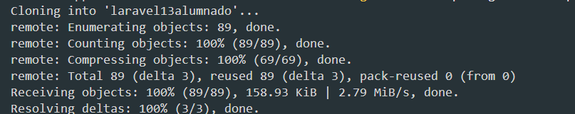

Fijaros cómo todavía falta VENDOR

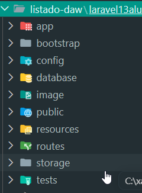


Entramos en la carpeta descargada:

```
cd laravel13alumnado
```

Abrimos el proyecto en Visual Studio Code:

```
code .
```

## 3. Instalar las dependencias

El repositorio contiene el archivo `composer.json`, donde se definen las dependencias PHP que necesita la aplicación.

Ejecutamos:

```
composer install
```

Composer instalará las dependencias en la carpeta `vendor`.

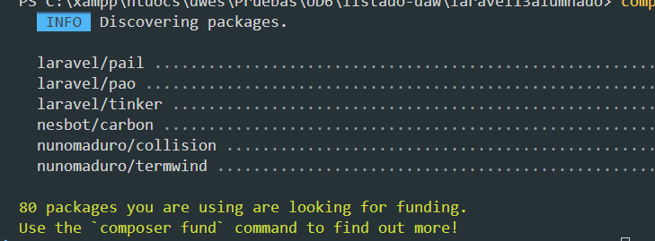

Importante: no utilizamos `composer create-project`, porque el proyecto ya está creado y lo hemos descargado desde GitHub.

## 4. Crear y configurar el archivo .env

> Vemos cómo **NO** se descarga el archivo **.env**

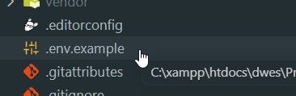

Laravel utiliza el archivo `.env` para guardar la configuración específica de cada equipo, incluida la conexión con MySQL.

En la carpeta principal encontraremos `.env.example`. Creamos una copia y la llamamos `.env`.

En Windows (PowerShell):

```
Copy-Item .env.example .env
```

En Linux o macOS:

```
cp .env.example .env
```

Editamos las siguientes variables del archivo `.env`:

```
APP_NAME="IES Francisco de los Rios"
APP_ENV=local
APP_DEBUG=true
APP_URL=http://127.0.0.1:8000

DB_CONNECTION=mysql
DB_HOST=127.0.0.1
DB_PORT=3306
DB_DATABASE=daw_laravel
DB_USERNAME=root
DB_PASSWORD=
```

| Variable          | Significado                                      |
| ----------------- | ------------------------------------------------ |
| `APP_NAME`      | Nombre de la aplicación                         |
| `APP_ENV`       | Entorno de ejecución: local                     |
| `APP_DEBUG`     | Mostrar errores detallados durante el desarrollo |
| `APP_URL`       | Dirección local de la aplicación               |
| `DB_CONNECTION` | Motor de base de datos utilizado                 |
| `DB_HOST`       | Dirección del servidor MySQL                    |
| `DB_PORT`       | Puerto del servicio MySQL                        |
| `DB_DATABASE`   | Nombre de la base de datos                       |
| `DB_USERNAME`   | Usuario de MySQL                                 |
| `DB_PASSWORD`   | Contraseña del usuario                          |

Atención: si el usuario `root` de MySQL tiene contraseña, debemos escribirla en `DB_PASSWORD`. No se debe subir el archivo `.env` a GitHub.

Las demás variables del archivo pueden mantenerse con sus valores predeterminados para esta práctica.

## 5. Crear la base de datos MySQL

Comprobamos que el servidor MySQL está iniciado.

Podemos utilizar MySQL Workbench, phpMyAdmin o el cliente de terminal.

Entramos en MySQL, por ejemplo:

```
mysql -u root -p
```

Introducimos la contraseña cuando se solicite y ejecutamos:

```
CREATE DATABASE daw_laravel
CHARACTER SET utf8mb4
COLLATE utf8mb4_unicode_ci;
```

Comprobamos que se ha creado:

```
SHOW DATABASES;
```

La base de datos `daw_laravel` aparecerá en el listado. Todavía no contendrá las tablas del proyecto.

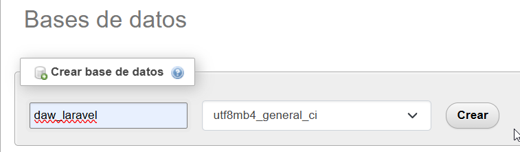


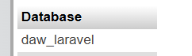


## 6. Generar la clave de Laravel

Vemos cómo todavía nuestra app no tiene clave en .env:

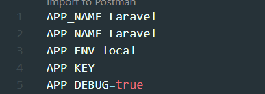


Volvemos a la terminal del proyecto y ejecutamos:

```
php artisan key:generate
```

Este comando genera la clave de aplicación y la guarda en la variable `APP_KEY` del archivo `.env`.

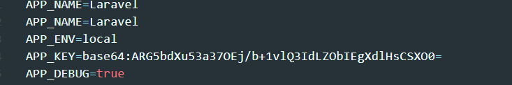

Ejemplo del formato que tendrá:

```
APP_KEY=base64:...
```

La clave real será generada automáticamente y no debemos inventarla ni copiar la de otro compañero.

## 7. Ejecutar las migraciones

Las migraciones permiten crear la estructura de las tablas de MySQL mediante código PHP.

Ejecutamos:

```
php artisan config:clear
php artisan migrate
```

Laravel creará las tablas definidas en las migraciones, incluida `alumnos`.

NOS DA UN ERROR, y le decimos que no, ¿qué está haciendo?

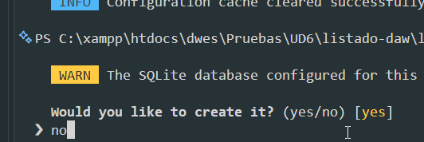

Es porque no hemos configurado nuestro MYSQL y va a hacerlo con SQLITE


Editamos el archivo `.env` del proyecto:

- importante señalar el nombre de la base de datos

```
daw_laravel
```


```
APP_NAME="IES Francisco de los Ríos"
APP_ENV=local
APP_DEBUG=true
APP_URL=http://localhost:8000

DB_CONNECTION=mysql
DB_HOST=127.0.0.1
DB_PORT=3306
DB_DATABASE=daw_laravel
DB_USERNAME=root
DB_PASSWORD=
```

El usuario y la contraseña deben adaptarse a la instalación local de MySQL.

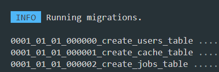


Podemos comprobarlo en MySQL:

```
USE daw_laravel;

SHOW TABLES;

DESCRIBE alumnos;
```

## 8. Insertar los 11 alumnos con seeders

Los seeders permiten introducir datos de prueba en la base de datos.

Ejecutamos:

```
php artisan db:seed
```

El seeder del proyecto insertará los 11 alumnos ficticios.

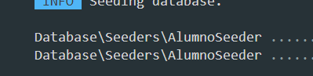

Comprobamos los registros desde MySQL:

```
SELECT * FROM alumnos;
```

Si todo es correcto, la consulta devolverá 11 filas.

## 9. Ejecutar la aplicación Laravel

Iniciamos el servidor de desarrollo:

```
php artisan serve
```

Abrimos el navegador en:

Listado de alumnos

[http://127.0.0.1:8000/alumnos](http://127.0.0.1:8000/alumnos?utm_source=chatgpt.com)

&#x20;Copiar dirección

La página deberá mostrar el título IES FRANCISCO DE LOS RÍOS, una tabla con los nombres y apellidos de los 11 alumnos y el número total de registros.

## 10. Comprobación final de la práctica

Lista de verificación

* [ ] He clonado el repositorio desde GitHub.
* [ ] He ejecutado composer install correctamente.
* [ ] He creado y configurado el archivo .env.
* [ ] He creado la base de datos daw_laravel en MySQL.
* [ ] He generado APP_KEY con Artisan.
* [ ] He ejecutado las migraciones sin errores.
* [ ] He insertado los 11 alumnos mediante el seeder.
* [ ] Puedo visualizar el listado en el navegador.

## 11. Errores habituales

| Error                              | Posible solución                         |
| ---------------------------------- | ----------------------------------------- |
| `vendor/autoload.php not found`  | Ejecutar `composer install`             |
| `No application encryption key`  | Ejecutar `php artisan key:generate`     |
| `Access denied for user`         | Revisar `DB_USERNAME` y `DB_PASSWORD` |
| `Unknown database 'daw_laravel'` | Crear la base de datos en MySQL           |
| `could not find driver`          | Habilitar la extensión PHP `pdo_mysql` |
| `Connection refused`             | Iniciar MySQL y revisar el puerto         |
| `Table 'alumnos' doesn't exist`  | Ejecutar `php artisan migrate`          |
| No aparecen alumnos                | Ejecutar `php artisan db:seed`          |

## 12. Actividad final 

Una vez que la aplicación funcione correctamente, cada alumno deberá realizar estas tres tareas:

1. Cambiar el nombre del centro en la vista Blade para comprobar qué archivo genera el HTML.
2. Modificar el seeder, sustituyendo uno de los nombres ficticios por su propio nombre, y reconstruir los datos de prueba mediante `php artisan migrate:fresh --seed` (solo en esta base de datos de prácticas).
3. Realizar una captura del listado en el navegador y otra de la consulta `SELECT * FROM alumnos;` en MySQL.

Entrega en Moodle Centros: dos capturas de pantalla y una breve explicación de qué hacen los comandos `composer install`, `php artisan key:generate`, `php artisan migrate` y `php artisan db:seed`.

La práctica se considerará completada cuando la aplicación funcione utilizando la base de datos MySQL local, sin depender de una base de datos de otro equipo.

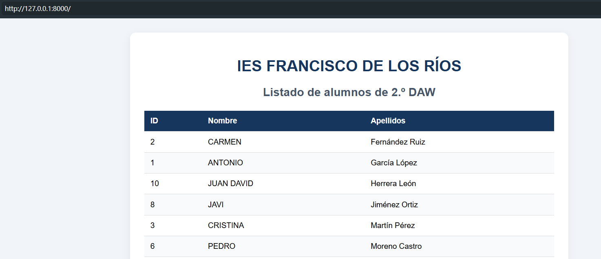

---

# 2 CREACIÓN Proyecto Laravel 13: Listado de alumnos de 2.º DAW

Vamos a desarrollar una aplicación sencilla con Laravel 13, PHP y MySQL que muestre un listado de 11 alumnos de Desarrollo de Aplicaciones Web del IES Francisco de los Ríos.

El objetivo es que el alumnado comprenda el funcionamiento básico de Laravel siguiendo el patrón MVC (Modelo–Vista–Controlador), utilizando migraciones, seeders, rutas y plantillas Blade.

## 1. Resultado final del proyecto

La aplicación mostrará una página con el nombre del centro, el ciclo formativo y una tabla con los alumnos almacenados en MySQL.

## IES FRANCISCO DE LOS RÍOS

2.º Desarrollo de Aplicaciones Web

Curso 2026/2027

Listado de alumnos

11 alumnos

| ID | Nombre    | Apellidos       |
| -- | --------- | --------------- |
| 1  | Alejandro | García López  |
| 2  | Lucía    | Fernández Ruiz |
| 3  | Daniel    | Martín Pérez  |
| 4  | María    | Sánchez Torres |
| 5  | Pablo     | Romero Díaz    |
| 6  | Carmen    | Moreno Castro   |
| 7  | Javier    | Navarro Molina  |
| 8  | Elena     | Jiménez Ortiz  |
| 9  | Adrián   | Ramos Vega      |
| 10 | Paula     | Herrera León   |
| 11 | Sergio    | Muñoz Gil      |

Ejemplo con nombres ficticios, generados mediante un seeder.

## 2. Estructura del proyecto

Utilizaremos estos componentes:

| Componente        | Función                      |
| ----------------- | ----------------------------- |
| MySQL             | Almacenar los alumnos         |
| Migración        | Crear la tabla `alumnos`    |
| Modelo `Alumno` | Representar los registros     |
| Seeder            | Insertar 11 alumnos ficticios |
| Controlador       | Consultar los alumnos         |
| Ruta              | Acceder al listado            |
| Vista Blade       | Mostrar la tabla HTML         |

El flujo será:

Navegador

GET /alumnos

Ruta → AlumnoController

Modelo Alumno → MySQL

SELECT \* FROM alumnos

Vista alumnos/index.blade.php

Tabla HTML con los 11 alumnos

## 3. Crear el proyecto Laravel

Necesitamos PHP compatible con Laravel 13, Composer, MySQL y las extensiones PHP necesarias, especialmente `pdo_mysql`.

Desde una terminal:

```
composer create-project laravel/laravel listado-daw "^13.0"
cd listado-daw
```

Generamos la clave de aplicación, si todavía no existe:

```
php artisan key:generate
```

## 4. Configurar MySQL

Primero creamos una base de datos desde phpMyAdmin o el cliente MySQL:

```
CREATE DATABASE daw_laravel
CHARACTER SET utf8mb4
COLLATE utf8mb4_unicode_ci;
```

Editamos el archivo `.env` del proyecto:

```
APP_NAME="IES Francisco de los Ríos"
APP_ENV=local
APP_DEBUG=true
APP_URL=http://localhost:8000

DB_CONNECTION=mysql
DB_HOST=127.0.0.1
DB_PORT=3306
DB_DATABASE=daw_laravel
DB_USERNAME=root
DB_PASSWORD=
```

El usuario y la contraseña deben adaptarse a la instalación local de MySQL.

## 5. Crear el modelo y la migración

Ejecutamos:

```
php artisan make:model Alumno -m
```

Se generan dos archivos principales:

- `app/Models/Alumno.php`
- `database/migrations/xxxx_xx_xx_xxxxxx_create_alumnos_table.php`

### Migración

Editamos la migración generada:

```
<?php

use Illuminate\Database\Migrations\Migration;
use Illuminate\Database\Schema\Blueprint;
use Illuminate\Support\Facades\Schema;

return new class extends Migration
{
    public function up(): void
    {
        Schema::create('alumnos', function (Blueprint $table) {
            $table->id();
            $table->string('nombre', 100);
            $table->string('apellidos', 150);
            $table->timestamps();
        });
    }

    public function down(): void
    {
        Schema::dropIfExists('alumnos');
    }
};
```

La migración crea una tabla con `id`, `nombre`, `apellidos`, `created_at` y `updated_at`.

### Modelo Alumno

Archivo `app/Models/Alumno.php`:

```
<?php

namespace App\Models;

use Illuminate\Database\Eloquent\Model;

class Alumno extends Model
{
    protected $fillable = [
        'nombre',
        'apellidos',
    ];
}
```

Este modelo permitirá consultar la tabla `alumnos` mediante Eloquent ORM.

## 6. Crear el seeder con los 11 alumnos

Ejecutamos:

```
php artisan make:seeder AlumnoSeeder
```

Editamos `database/seeders/AlumnoSeeder.php`:

```
<?php

namespace Database\Seeders;

use App\Models\Alumno;
use Illuminate\Database\Seeder;

class AlumnoSeeder extends Seeder
{
    public function run(): void
    {
        $alumnos = [
            ['nombre' => 'Alejandro', 'apellidos' => 'García López'],
            ['nombre' => 'Lucía', 'apellidos' => 'Fernández Ruiz'],
            ['nombre' => 'Daniel', 'apellidos' => 'Martín Pérez'],
            ['nombre' => 'María', 'apellidos' => 'Sánchez Torres'],
            ['nombre' => 'Pablo', 'apellidos' => 'Romero Díaz'],
            ['nombre' => 'Carmen', 'apellidos' => 'Moreno Castro'],
            ['nombre' => 'Javier', 'apellidos' => 'Navarro Molina'],
            ['nombre' => 'Elena', 'apellidos' => 'Jiménez Ortiz'],
            ['nombre' => 'Adrián', 'apellidos' => 'Ramos Vega'],
            ['nombre' => 'Paula', 'apellidos' => 'Herrera León'],
            ['nombre' => 'Sergio', 'apellidos' => 'Muñoz Gil'],
        ];

        foreach ($alumnos as $alumno) {
            Alumno::create($alumno);
        }
    }
}
```

El método `create()` inserta cada alumno en MySQL utilizando el modelo Eloquent.

### Registrar el seeder

Editamos `database/seeders/DatabaseSeeder.php`:

```
<?php

namespace Database\Seeders;

use Illuminate\Database\Seeder;

class DatabaseSeeder extends Seeder
{
    public function run(): void
    {
        $this->call(AlumnoSeeder::class);
    }
}
```

### Ejecutar migraciones y seeders

```
php artisan migrate
php artisan db:seed
```

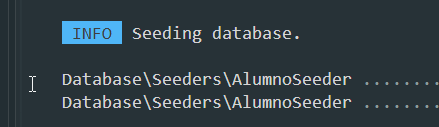

Para comprobar los registros desde MySQL:

```
SELECT * FROM alumnos;
```

Deberían aparecer los 11 alumnos.

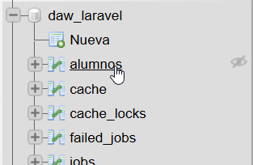

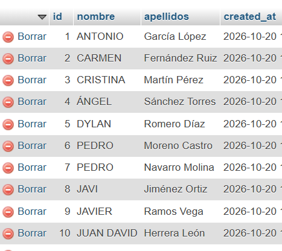

## 7. Crear el controlador

Ejecutamos:

```
php artisan make:controller AlumnoController
```

Editamos `app/Http/Controllers/AlumnoController.php`:

```
<?php

namespace App\Http\Controllers;

use App\Models\Alumno;

class AlumnoController extends Controller
{
    public function index()
    {
        $alumnos = Alumno::orderBy('apellidos')->get();

        return view('alumnos.index', [
            'alumnos' => $alumnos
        ]);
    }
}
```

Explicación: `Alumno::orderBy('apellidos')->get()` consulta todos los alumnos de MySQL y los ordena alfabéticamente por apellidos. Después, `view()` envía los datos a la plantilla Blade.

## 8. Crear la ruta

Editamos `routes/web.php`:

```
<?php

use Illuminate\Support\Facades\Route;
use App\Http\Controllers\AlumnoController;

Route::get('/', [AlumnoController::class, 'index']);

Route::get('/alumnos', [AlumnoController::class, 'index']);
```

De esta manera, el listado será accesible tanto desde `/` como desde `/alumnos`.

## 9. Crear la vista Blade

Creamos la carpeta `resources/views/alumnos` y dentro el archivo `index.blade.php`.

La vista utiliza HTML, CSS y las directivas `@foreach` y `{{ }}` de Blade. No necesita JavaScript ni compilar recursos con Vite.

```

<!DOCTYPE html>
<html lang="es">
<head>
    <meta charset="UTF-8">
    <meta name="viewport"
          content="width=device-width, initial-scale=1.0">
    <title>Alumnos de DAW</title>

    <style>
        body {
            font-family: Arial, sans-serif;
            background: #f1f5f9;
            margin: 0;
            padding: 30px;
        }

        .contenedor {
            max-width: 850px;
            margin: auto;
            background: white;
            padding: 30px;
            border-radius: 12px;
            box-shadow: 0 4px 15px #0001;
        }

        h1, h2 {
            text-align: center;
        }

        h1 {
            color: #17365d;
        }

        h2 {
            color: #475569;
        }

        table {
            width: 100%;
            border-collapse: collapse;
            margin-top: 25px;
        }

        th {
            background: #17365d;
            color: white;
        }

        th, td {
            padding: 12px;
            border-bottom: 1px solid #ddd;
            text-align: left;
        }

        tr:nth-child(even) {
            background: #f8fafc;
        }

        .total {
            margin-top: 20px;
            font-weight: bold;
        }
    </style>
</head>

<body>
    <div class="contenedor">

        <h1>IES FRANCISCO DE LOS RÍOS</h1>

        <h2>Listado de alumnos de 2.º DAW</h2>

        <table>
            <thead>
                <tr>
                    <th>ID</th>
                    <th>Nombre</th>
                    <th>Apellidos</th>
                </tr>
            </thead>

            <tbody>
                @foreach ($alumnos as $alumno)
                    <tr>
                        <td>{{ $alumno->id }}</td>
                        <td>{{ $alumno->nombre }}</td>
                        <td>{{ $alumno->apellidos }}</td>
                    </tr>
                @endforeach
            </tbody>
        </table>

        <p class="total">
            Total de alumnos: {{ $alumnos->count() }}
        </p>

    </div>
</body>
</html>

```

## 10. Ejecutar el proyecto

Primero, si hemos modificado la configuración de la base de datos:

```
php artisan config:clear
```

Iniciamos el servidor:

```
php artisan serve
```

Abrimos en el navegador:

[http://127.0.0.1:8000/alumnos](http://127.0.0.1:8000/alumnos?utm_source=chatgpt.com)

&#x20;Copiar

Deberá aparecer el encabezado IES FRANCISCO DE LOS RÍOS, seguido de los 11 alumnos recuperados de MySQL.

Si necesitas reconstruir la base de datos desde cero durante las prácticas, puedes ejecutar:

```
php artisan migrate:fresh --seed
```

Atención: `migrate:fresh` elimina todas las tablas de la base de datos configurada. Debe utilizarse exclusivamente en una base de datos de pruebas.

## 11. Comprobación del aprendizaje

Para comprobar que el alumnado entiende el proyecto, propongo cuatro pequeñas modificaciones:

1. Añadir un campo `email` mediante una nueva migración y mostrarlo en la tabla.
2. Modificar el seeder para incluir un alumno adicional.
3. Ordenar el listado por nombre en lugar de apellidos.
4. Mostrar un mensaje cuando no existan alumnos, utilizando `@forelse` y `@empty` de Blade.

El ejercicio completo permite trabajar los fundamentos de rutas, controladores, modelos Eloquent, migraciones, seeders y vistas Blade, sin introducir todavía formularios, autenticación ni operaciones CRUD.
